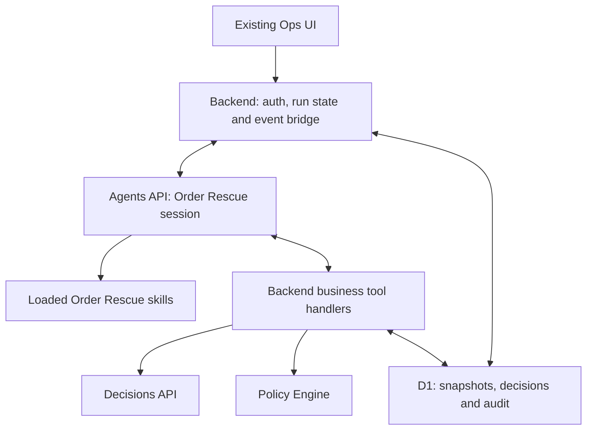

# Order Rescue — Agents API, Skills and Decisions Migration

## Execution brief

Implement this migration in the current repository. Complete code, meaningful verification and a truthful handover. This document supersedes the orchestration design in `OrderRescue_Decisions_Backend_Implementation_Plan.md`: do not first build its fixed sequence of separate generation calls and then migrate again.

The intended architecture is **OpenAI Agents API with a managed agent session, real skills and callable business tools**. Prioritize LLM and Decisions for semantic assessment. Keep code responsible for data integrity, permissions, explicit policy constraints and persistence.

Read applicable `AGENTS.md` files first. The reviewed branch was `phuc-dev`, commit `f10439ff034ad4d64fd555d64ee925b20b4d7b09`; active code was under `Prototype-OpenAI/lib/order-rescue-v2/`. Inspect the current checkout rather than assuming it is unchanged. Preserve unrelated work.

The user explicitly authorizes this runtime migration. Where repository instructions describe the former fixed seven-stage runtime, update those descriptions to reflect the authorized architecture. Preserve the BI business contract unless this plan explicitly changes an implementation responsibility.

## Scope boundaries

- Preserve Workers/D1, authentication, owner isolation, synthetic datasets and recommendation-only behavior.
- **No UI changes:** do not edit pages, components, CSS or frontend interaction logic. Keep existing API fields compatible and add metadata separately. Backend serializers may be adapted for compatibility.
- Preserve the v2.2 one-question/two-assessment baseline. Multi-turn beyond one buyer question is deferred.
- Keep legacy SDK/Replay execution available as an explicit rollback path. Never silently fall back to it when Agents API fails.
- Do not modify source BI fixtures or expected labels to make tests pass.
- Do not send messages to real buyers, dispatch, change address/COD, return parcels, refund or cancel orders.
- Do not deploy, publish, push, or install personal ChatGPT skills.

## 1. Verify the real API and prove the integration seam

Read current official documentation and check installed SDK support:

- https://developers.openai.com/api/docs/guides/agents-api/overview
- https://developers.openai.com/api/docs/guides/agents-api/architecture
- https://developers.openai.com/api/docs/guides/agents-api/sessions
- https://developers.openai.com/api/docs/guides/agents-api/tools/functions
- https://developers.openai.com/api/docs/guides/agents-api/tools/plugins
- https://developers.openai.com/api/docs/guides/decisions

Use genuine Agents API session operations, not `Runner.run()` over Responses renamed as an Agents API client. In the reviewed documentation the JavaScript entry point was `client.beta.agents.sessions`; reverify rather than assuming endpoint, schema or model compatibility.

Verify configured account/model access, environment setup, plugin/skill loading, pending tool-call handling, tool-result submission and session continuation. Do not assume the existing assessment model supports the new runtime. Make the selected supported agent model configurable.

First implement a narrow spike with a synthetic snapshot:

1. Create an Agents API session with a loaded skill.
2. Agent requests a business tool.
3. Backend executes one real Decisions request through that tool.
4. Backend submits the correlated tool result.
5. Agent continues and submits a structured assessment proposal.
6. Record actual session/turn/tool-call identifiers and API outcomes.

With credentials unavailable, build this seam and test it using explicitly labeled mocks, then continue independent implementation. Report live validation as blocked. Never claim the spike succeeded from mocked calls or an SDK typecheck alone.

## 2. Target architecture and responsibility split



| Component | Responsibility |
| --- | --- |
| Managed agent | Extract evidence, interpret buyer statements, identify missing information, invoke decision tools, compose questions and explain results |
| Agents API | Model/tool loop and durable agent-session context |
| Application backend | Authoritative case state, event handling, pending tool dispatch, authorization and run/session mapping |
| Decision tools | Versioned semantic questions, real Decisions calls and immutable results |
| Policy Engine | Explicit operational constraints and permission to accept a proposed result |
| D1 | Authoritative business snapshots, decision records and audit |

Use one main agent. Do not introduce specialist agents or agent-as-tool layers for this MVP.

Managed session recovery is not a substitute for application-level idempotency, database transactions or business state recovery.

## 3. Environment and skill delivery

Prefer an **OpenAI-hosted environment** for actual skill/plugin files. Package and load the skills using the documented mechanism. Verify loading through session behavior and available diagnostics; a checked-in `SKILL.md` alone is not integration.

Keep business data and tool implementations behind the existing backend. Do not put D1 credentials or an unrestricted OpenAI API key inside an agent-accessible workspace. No self-hosted executor is required merely to access D1 through tools.

Use backend-handled function tools as the default transport. If a combined skill+MCP plugin is chosen instead, implement and verify that transport explicitly. Do not claim a plugin manifest automatically exposes TypeScript functions. Use one tool transport per capability rather than duplicating function and MCP versions unnecessarily.

An environment-free session can be a diagnostic fallback for testing function tools, but it does not satisfy the skill-loading acceptance criterion. If hosted skill support is blocked, report it instead of calling prompt text a loaded skill.

## 4. Skills

Implement concise app-local skills:

### `investigate-case`

- Load the current snapshot.
- Separate raw source observations, extracted evidence and inferred hypotheses.
- Preserve provenance and contradictions.
- Interpret dates using source time and snapshot cutoff.
- Do not trust old conversation conclusions over a newer authoritative snapshot.

### `assess-decisions`

- Call the hypothesis tool after evidence extraction.
- Assess buyer facts and missing information after the hypothesis result.
- Call the action tool using that updated context.
- Preserve decision IDs, raw probabilities and API confidence.
- Handle unknown, conflict, refusal and tool errors without fabricated outputs.
- Never equate selected-action probability with delivery-success probability.

### `clarify-buyer`

- Identify a buyer-answerable missing fact that could change handling.
- Compose a short relevant question consistent with the BI question category.
- Avoid asking for facts already supplied.
- Request backend permission; never assume remaining budget from memory.
- Stop the turn after an accepted pending question. Do not simulate a buyer reply.

### `recommend-recovery`

- Assemble the exact BI assessment using recorded decision results.
- Submit for policy validation.
- Explain candidate versus final action using sources and policy reasons.
- Treat a recommendation as decision support, never completed logistics execution.

Do not turn audit, schema checks and persistence into optional skills. Backend must perform those operations regardless of agent behavior.

## 5. Business tools

Suggested names are internal contracts, not claims about native API features.

| Tool | Purpose and required checks |
| --- | --- |
| `get_case_snapshot` | Return current raw input, provenance registry, phase, current question state and budgets; backend binds owner/run |
| `evaluate_hypothesis` | Validate extracted evidence, call Decisions over the seven BI causes, score evidence support and persist the result |
| `evaluate_action` | Validate current hypothesis decision and model-assessed buyer facts/missing information; call Decisions over the five BI actions |
| `submit_assessment` | Resolve stored decision IDs, validate exact assessment schema, run policy and persist the accepted phase result |
| `request_clarification` | Validate accepted initial assessment, policy permission and one-question budget; save question text/key and pending state |

Tools must not trust an agent-supplied owner, budget, lifecycle flag, model identifier, policy version or probability. Resolve authoritative values server-side. Bind every tool call to its authenticated run/session.

Pass immutable IDs wherever possible. A decision tool should reload the authoritative raw snapshot rather than trusting an agent-authored copy of operational data. Extracted evidence and semantic facts remain model-derived claims with supporting references.

### Hypothesis decision

Use exact BI labels and definitions:

```text
AVAILABILITY_ISSUE
ADDRESS_ISSUE
CONTACT_ISSUE
BUYER_INTENT_ISSUE
PAYMENT_ISSUE
LOGISTICS_ISSUE
UNKNOWN_CAUSE
```

Input: current raw snapshot, source registry, extracted evidence and versioned hypothesis rubric. Exclude expected labels, future replies, prior candidate actions and self-reported numerical confidence.

Output: selected hypothesis, complete label probabilities, separate API confidence, evidence-support result and provenance.

### Action decision

Use exact BI labels and definitions:

```text
CLARIFY
STANDARD_REATTEMPT
HOLD_DISRUPTION
ESCALATE_REVIEW
NO_ACTION
```

Input: current raw snapshot/evidence, recorded hypothesis result, model-assessed buyer facts, missing information, phase and authoritative policy context.

Output: candidate action, complete action probabilities, separate API confidence and provenance.

Do not issue action selection before its required hypothesis/assessment context exists. Do not precompute every answer by code or use case IDs to choose labels.

### Confidence compatibility

Retain evidence-support scoring for the selected hypothesis to populate BI `LOW/MEDIUM/HIGH`. Existing Decisions scoring can run inside `evaluate_hypothesis` after the cause is selected. Keep its rubric and demo threshold semantics explicit.

Do not substitute hypothesis probability or API confidence for evidence support. Store these signals separately:

- Hypothesis-choice distribution and API confidence.
- Evidence-support score/distribution, API confidence and BI band.
- Action-choice distribution and API confidence.

Direct buyer evidence must concern the selected cause; an intent-only reply does not confirm why the previous attempt failed. Any validation cap must preserve the raw score and reason.

## 6. Semantic reasoning versus code rules

Use the main LLM and/or Decisions for:

- Buyer intent, refusal, conditional statements and receiving arrangements.
- COD readiness and uncertainty.
- Landmark clarification versus a request to change location.
- Whether sources conflict and what remains unresolved.
- Cause selection, evidence sufficiency and candidate action.

Remove active semantic regex from `buyerFacts()` and equivalent paths. Do not replace it with keyword dictionaries, substring classifiers, fixed Vietnamese phrase lists or case-specific mappings.

Use typed internal facts with explicit positive, negative, conditional, unknown and conflicting states where appropriate. Attach source references and unmodified supporting quotes. Reference/quote matching validates provenance, not semantic truth.

Retain code for:

- Schema/types/enums and source ownership/availability.
- Authoritative lifecycle, deadline and attempt constraints.
- Question budget, question/event IDs and access boundaries.
- Snapshot consistency, idempotency, concurrency and database writes.

Fixed BI labels, explicit policy limits and schema validation are required contracts, not prohibited semantic hardcoding. Do not remove them merely to make the app appear more agentic.

## 7. Business workflow and session lifecycle

### Initial

1. Authenticate and create the business run; apply prechecks.
2. Persist run/session setup status and create an Agents API session.
3. Bind one session to that run. Isolate owners and independent demo runs.
4. Agent loads snapshot, extracts evidence and invokes hypothesis scoring.
5. Agent assesses buyer facts/missing information and invokes action selection.
6. Agent submits assessment; backend validates and runs policy.
7. If clarification is permitted, accept one question and save `WAITING_FOR_BUYER`.
8. Otherwise finalize according to the existing documented no-question convention.

Do not keep a live request or turn waiting for the buyer for hours. The agent ends its current turn after saving the pending question.

### Matching reply

1. Validate pending question and reserve the business event.
2. Persist the actual reply and create a new snapshot/version.
3. Send a continuation task to the same session with the new snapshot reference.
4. Agent reloads current data and reassesses through the decision tools.
5. Backend saves after-reply assessment/policy and selects phase two as final.

One-question BI baseline still applies. Session continuation support does not authorize a second clarification question. A completed agent turn is not automatically a completed business case.

Session history may contain earlier reasoning. It is not an authoritative current input. Decisions tools receive only the explicit current snapshot and validated proposal; expected labels and unreleased scripted replies must never enter the agent session.

### No reply

Process manual `USER_NO_REPLY` entirely in backend. Copy stored initial assessment/policy exactly, keep after-reply null, write final-selection audit and reject late conflicting commits. Do not call the agent or Decisions to finalize.

## 8. Mandatory commit validation

Instructions alone must not enforce required steps. Before accepting an assessment, backend must verify the chain:

```text
current snapshot
  -> recorded hypothesis decision and evidence-support score
  -> recorded action decision using that hypothesis/context
  -> accepted six-field assessment
  -> policy output
```

- Resolve selected labels/probabilities from stored results, not values repeated by the agent.
- Bind action decisions to the hypothesis result and hash/version of evidence, buyer facts and missing information used.
- Reject stale, foreign, incomplete or inconsistent proposals.
- A structured submission tool is the commit boundary; free-text agent output is never a database instruction.
- Keep candidate action and probabilities even when policy changes the final action. Do not assign candidate probability to a substitute action.
- If the agent omits required tools, do not accept a partial result as success. Allow only bounded corrective continuation, then a recorded error/review state.

Keep public assessment exactly six BI fields. Store additional metadata outside it. Preserve compatibility with old D1 records and the unchanged UI.

## 9. Event bridge, persistence and recovery

Implement the documented pending-function flow: receive required calls, execute handlers and submit results correlated to session/turn/call IDs. Handle streaming or webhooks using a deployment-compatible strategy; do not assume a browser connection survives the whole turn.

- Persist session ID, turn/execution IDs, business phase, snapshot version, tool-call ledger and decision IDs.
- Deduplicate event delivery and tool-result handling.
- Bound tool execution and request budgets. Persist in-progress/error states.
- Reconcile unfinished work by retrieving session/call status. Do not blindly recreate sessions or resend potentially billable Decisions requests after uncertain completion.
- Store completed tool results for safe replay of result delivery without rerunning inference.
- Do not claim exactly-once external billing under crash conditions. Mark ambiguous outcomes for explicit recovery.
- Do not hold a database transaction open during remote inference.
- Maintain lease/revision protection across long asynchronous turns and reject late stale writes.
- Keep secrets server-side and use narrow tool permissions. Do not expose general SQL or unrestricted execution against D1.

Record per-call latency, available SDK usage, model, prompt/rubric version, snapshot hash and completion/error status. Unavailable usage stays unknown, not zero. Distinguish agent-model usage from hypothesis, support and action Decisions usage.

## 10. Implementation sequence

1. Baseline checks and verified API/skill/tool spike.
2. Reusable Decisions service and typed result persistence.
3. New app-local skills/plugin bundle and backend business tools.
4. Agents API session adapter, event bridge and run/session mapping.
5. Assessment commit validation and policy integration without semantic regex.
6. Initial/reply/no-reply integration, compatibility and recovery.
7. Regression, real-backend tests and bounded live rehearsal.

Use explicit runtime selection for rollout and rollback. Keep Replay clearly labeled and do not invent agent session IDs or API probabilities for fixture execution. Only switch the default live runtime after the relevant gates pass; otherwise report the new path as incomplete/blocked.

## 11. Acceptance and testing

### Semantic cases

- Intent only: no unsupported retry.
- “Vẫn muốn nhận, nhưng mai không có người nhận”: availability is not confirmed.
- Clear arrangement at the existing address: retry can be permitted.
- “Không đổi địa chỉ”: not an address-change request.
- Actual address change: review.
- COD readiness unknown: no retry where required.
- Active verified disruption: buyer intent does not override it.
- Intent-only evidence: no unjustified HIGH confidence for the prior cause.
- Paraphrases and conditional/contradictory statements receive semantic assessment, not exact phrase matching.

### Runtime and business cases

- Real session creation, skill loading and tool-result continuation.
- Reply continuation uses the same run/session and a new snapshot.
- Required decision results cannot be skipped, forged or reused across snapshots.
- One-question limit and exact no-reply copy hold.
- Duplicate/late events, stale commits, tool failures and interrupted execution are handled.
- Owner/run isolation and expected/future-data isolation hold.
- API response compatibility and persistence/restore hold without frontend changes.
- Policy overrides preserve original decision metadata.

Run tests, typecheck and production build. Exercise actual backend handlers with isolated D1 where supported. Clearly distinguish mocked SDK/event tests, Replay regression, real-backend tests and live API evidence.

Use configured credentials only, synthetic data only and no automatic retries. Set a live experiment budget: at most 30 Decisions requests, at most two business sessions and a configurable agent token/turn budget. Count failed attempts and any corrective inference. Stop on auth/quota errors. Do not assume one agent turn equals one model request.

If access or skill/environment setup is blocked, finish independent work and document the blocked gates. Never claim successful Agents API integration based on Responses calls or mocks.

## 12. Handover

Write `reports/agents-api-migration.md` covering:

- Actual final architecture, supported API/model/SDK versions and environment choice.
- Loaded skills, tool transport and code map.
- Session lifecycle, function-call protocol and business state transitions.
- Decisions input/output contracts and confidence meanings.
- Database/API compatibility and recovery behavior.
- Exact setup/start commands, environment variable names and skill packaging steps without secrets.
- Actual validation results, mock boundaries, live request counts and blockers.
- Rollback instructions and remaining limitations.

Update stale runtime instructions/documentation in the repository. Finish with implemented code and a concise truthful status. No UI modifications, deployment, publication or push.
